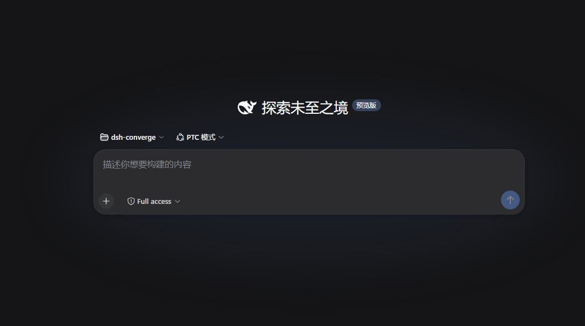
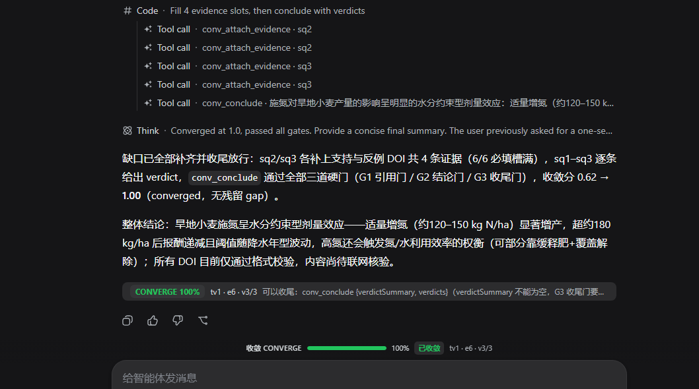
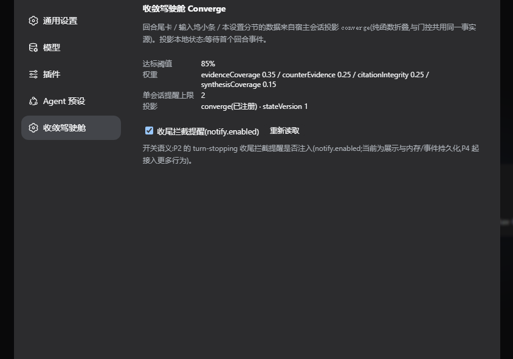
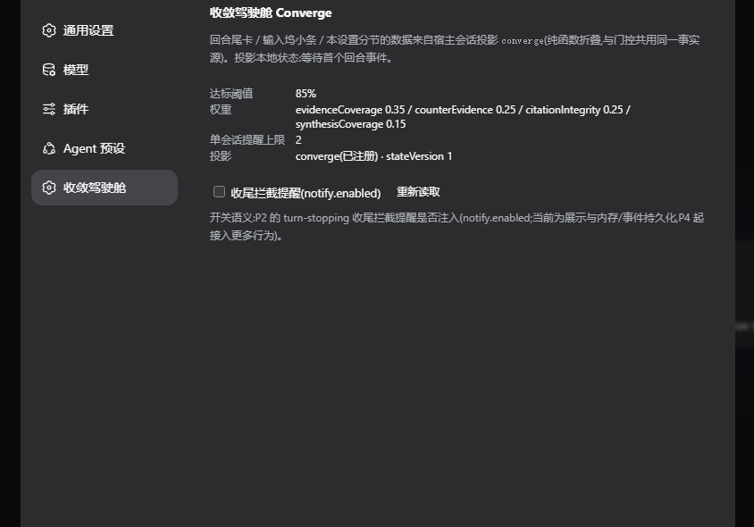

# dsh-converge — 科研收敛驾驶舱 (developer preview)

> npm 包名是 scoped 的 `@uppercrusteve/dsh-converge`；仓库在
> `github.com/uppercrusteve/dsh-converge`。下文所有命令用全名。

给 DSH 智能体装一副「研究收敛仪表盘」：把一次研究/综述任务拆成研究树，随做随记证据与缺口，
收尾前必须过三道硬门（G1 引用可解析 / G2 每个已作答子问题有结论 / G3 收尾正文非空）且总分
≥0.85 才放行；不达标时回合末最多注入两次带「缺口 + 最短补法」的提醒。全部控制面以私有会话
事件（`converge/*`）事件溯源落盘，不进模型可见历史；宿主侧纯函数投影把同一份状态同时供给
浏览器端三块 UI（回合尾卡 / 输入坞驾驶舱条 / 设置分节）与 `convergeApi` RPC。零 npm 依赖。

```
conv_plan  施氮梯度对旱地小麦产量的影响 → sq1/sq2/sq3（每问必填支持槽+反例槽）
conv_attach_evidence ×N → conv_score 0.62 …缺口点名 + 最短补法… → conv_conclude 1.00 放行
```

## 安装

```bash
# GitHub 仓库（推荐 developer preview 形态；本包无构建脚本，pnpm 不需要 allowBuilds 放行，已实测）
dsh plugin --profile web add github:uppercrusteve/dsh-converge
# 锁 tag（发布推荐写法，可复现；pnpm 会把 #v0.1.0 归一成 commit 写进 lockfile）
dsh plugin --profile web add github:uppercrusteve/dsh-converge#v0.1.0
# npm（当前只发 preview tag，必须显式带 tag；不带 tag 会解析不到）
dsh plugin --profile web add @uppercrusteve/dsh-converge@preview
# 本地调试（不安装，直接 patch 挂载；name 必须 file:/// URL，裸 D:\ 会被当协议炸掉整棵插件树）
node "<dsh bin>" --profile web --patch "examples/converge.dev-fileurl.patch.yml" --port 18794 --no-open
```

> 安装形态验证状态（做到哪写到哪）：`file:` 真装 + scoped bundle 路由已实测——profile
> deps/bundles 出现 `@uppercrusteve/dsh-converge`，`GET /plugins/@uppercrusteve/dsh-converge/client.js`
> 返回 200 且与磁盘逐字节一致（sha256 `0A96…166EEE`），BOOT 四事件 outcome=ok（typesTotal=9）；
> `remove` 后 dep/bundles 行/node_modules 三清除，cleanboot bundle 404、index 200、无树错误
> （证据 `tests/runs/RELEASE.audit.log`，REL.add/REL.gate/REL.rm/REL.cb，13 路径零污染）。
> `github:` 已实测（`github:owner/repo` 与 `#v0.1.0` 两形态，含 BOOT 四件套与 bundle 字节一致，
> 逐条判定见发布工作区 `notes/RELEASE.md` 的 G0–G2——工作区级文件，不在包内；包内 `notes/` 只有
> `CORE-ISSUE.md` 与 `pack-dryrun-scoped.txt`）：deps/bundles/node_modules 三处出现 scoped 名，
> `remove` 后三清除、cleanboot bundle 404 / index 200 / 无树错误
> （`REL.gh` / `REL.ghtag` / `REL.cb-gh`，13 路径零污染）。
> 一处 Windows 陷阱须知：git 安装走 `git clone` 检出，若客户端 `core.autocrlf=true`，仓库内 LF 的
> `lib/client.js` 会以 CRLF 落进 node_modules（20501→20847 B）；宿主 serve 出的字节与包内文件仍逐字节
> 一致（sha256 `1908…22F6`），且与 `file:`/npm 形态同一内容——CRLF→LF 归一化后 sha256 仍为 `0A96…166EEE`，
> 只是行尾差异，不影响语法与运行。要拿到与仓库 blob 逐字节一致的检出，本机设
> `git config --global core.autocrlf false`（或input），或在本包加 `.gitattributes` 后由发布者定稿。
> npm `@preview` 形态仍待发包后回测。

`add` 后 profile 的 `dsh.profile.bundles` 出现 `@uppercrusteve/dsh-converge`，宿主按
`package.json` 的 `dsh.bundle.patch`（= `examples/converge.bundle.patch.yml`，包名形态
insert 行）自动装载；包声明 `dsh.client.platform=="web"` + `exports["./client"]`，浏览器
bundle 走 `GET /plugins/@uppercrusteve/dsh-converge/client.js`（P3b 实证契约：包名可解析
才发 bundle，file:/// 名 404；scoped 名的 `@`/`/` 在宿主路由里按整段 pathname 匹配，已实测）。

## 四个工具面 · 七个 conv_* 工具

| 面 | 工具 | 一句话 |
|---|---|---|
| 立树 | `conv_plan` | 把研究问题拆成子问题树，每个子问题自带必填证据槽（支持+反例）。 |
| 立树 | `conv_add_subquestion` | 中途追加子问题；抬 treeVersion，旧版本证据自动隔离不再计分。 |
| 记证据 | `conv_attach_evidence` | 挂一条 doi/pmid/arXiv/url/zotero 引用到指定槽位，stance=counter 自动落反例槽；同 ref 重挂去重不虚增。 |
| 记证据 | `conv_mark_gap` | 明示「这条补不动」的缺口（白名单 code），只认账不加分，可豁免引用待核验。 |
| 打分 | `conv_score` | 实时四维分（覆盖 0.35/反例 0.25/引用完整 0.25/综述结论 0.15）+ 缺口点名 + 最短补法。 |
| 打分 | `conv_status` | 查看当前树/槽位/证据/缺口全景。 |
| 收尾 | `conv_conclude` | 申请收尾：三门一分全过才放行；补不动用 `force+residualGaps` 带缺口收尾（记 converged-with-gaps，不自称收敛）。 |

## 三块界面（P4 浏览器实点截图）

-  **S1** 宿主首页：插件装载无横幅（`HARNESS Failed to load plugins` 消失）。
-  **S2** 真实聊天回合：回合尾卡（`CONVERGE 100% tv1·e6·v3/3` +
  nextBestAction）与输入坞驾驶舱条（`收敛 CONVERGE 100% 已收敛`）同时渲染。
-  **S3** 「收敛驾驶舱」分节：阈值/权重只读展示 +
  notify.enabled 开关（读写走 `convergeApi` RPC，落盘 `converge/setting` 会话事件）。
-  **S3b** 勾选翻转后的同一分节（RPC 写入 + 事件落盘后回读）。

> 上面四个相对链接指向 `docs/`，与 `src/`、`lib/`、`examples/`、`notes/` 同在 `package.json`
> 的 `files[]` 白名单里——`npm pack` 的 tarball 视角逐个可达（README 里出现的包内路径只有
> `docs/*`、`examples/*`、`notes/*` 三类，`tests/` 见文末说明）。
>
> 四张图已做脱敏裁切（发布前必查项）：切掉左侧会话栏、顶部会话标题行与底部 token 统计条，
> 并把输入框右下角的模型名徽标用同区域背景覆掉；裁后尺寸 S1/S2 为 1058x590、S3/S3b 为
> 844x590（原图 1418x746，未裁原件留在仓库 `notes/docs-uncropped/`，不在 `files[]` 里）。
> 复核口径：会话标题、模型名、token 统计这三类信息在包内四图中均不可见。

宿主 ≥0.1.1-rc.2 把 `conversation.chat.turnTail` 声明为 **chain 槽**（注册必须带
`options.select`，第一个非 null 当选）——本包已按此注册，勿在旧 rc 上混用旧 bundle。

## 事件类型注册面契约（对 core 的依赖声明）

宿主持久化读侧用 `KNOWN_SESSION_EVENT_TYPES` 词表裁决会话可否装载：不在表内且无 `ignorable`
标记 → `SessionFormatUnsupportedError`（装载即拒）。本插件 apply 期把 **9 个** 类型
（`converge/plan·evidence·gap·verdict·score·conclude·decision·setting·ping`）运行时
`.add()` 进该活 Set：探径 `argv1 → argvN → execPath → import.meta → 已知安装根`；**同实例探针**
= Set 必须已含本 build 词表条目（探针类型 `goal/change`），否则视为第二份拷贝拒注。
**失败降级语义**：注册是纯增量——任何一步失败只 `ctx.logger.warn`，本会话功能无损，仅带
`converge/*` 的**历史会话** resume 受限。日志事件名：`event-types-register`
（outcome=ok|degraded，含 mode/resolvedFrom/missingBefore/missingAfter 证据链），
另有 `projection-register` / `remote-mount` / `turn-tracker` 三枚启动事件。

**真装形态下探径日志的 import.meta candidates failures 属预期噪声（非告警），最终 outcome 为准**：
`dsh plugin add` 装进 profile `node_modules` 后，探径前两档（argv1/argvN）已能命中宿主
`dsh-session`，而末档 `import.meta` 兜底是在插件自身安装目录里找宿主包——真装形态下必然落空，
于是 candidates 数组里带一条 `import.meta` 的 failure 行。看的是 `outcome=ok` 与
`typesTotal=9`，不是 failures 数组是否为空。

给 core 的正式注册面 API 诉求见 `notes/CORE-ISSUE.md`（随包发布，npm 包内可直接打开；
仓库形态同名文件在 `notes/CORE-ISSUE.md`）。

## 已知限制

- **灰色面对宿主包布局敏感**：类型注册探径依赖 `argv[1]` 祖先链内能找到宿主 `node_modules`
  （headless/web 实测 ok；Electron/桌面形态未实测）——探针不符时自动降级而非误注册。
- **resume 前插件必须已装载**：官方装载顺序满足（loader.await 之后才 resume）；若手工编排
  启动顺序，先载插件再 resume。
- **developer preview 版本敏感**：宿主 rc 系列演进快（chain 槽 `options.select` 即 0.1.1-rc.2
  引入），建议锁 commit 安装（`github:uppercrusteve/dsh-converge#<sha>`），升级宿主后先跑回归。
- `verified=true` 仅代表引用**格式**校验通过，不等于内容已联网核实（事件里带
  `verifiedIsFormatOnly` 诚实标记）。

## 验证方式

```bash
node tests/score.test.mjs      # 打分/门控纯函数 16 组
node tests/plugin-smoke.mjs    # 假 ctx 全链路冒烟 15 组（7 工具真执行）
node tests/register.test.mjs   # 事件类型注册面探径/探针/降级 13 组
node tests/projection.test.mjs # 宿主投影折叠与打分对拍 10 组
```

> `tests/` 不在发布仓库与 npm 包里（本仓库根即插件目录；包只发运行时产物 + 文档）：这四条属
> 开发工作区——在工作区根跑（`tests/*.mjs` 以相对路径 `../plugin/src/converge.js` 引源码，
> 即 `tests/` 与本目录平级）。
> tarball 里的 `package.json` `files[]` 五件（`src/`、`lib/`、`examples/`、`docs/`、`notes/`）
> 加 `README.md` 由 `npm pack --dry-run` 核对（scoped 实名证据见仓库
> `notes/pack-dryrun-scoped.txt`：`@uppercrusteve/dsh-converge@0.1.0`，tarball 名
> `uppercrusteve-dsh-converge-0.1.0.tgz`，LICENSE 由 npm 自动附带）。

MIT · 仓库 `github.com/uppercrusteve/dsh-converge` · npm `@uppercrusteve/dsh-converge`。
